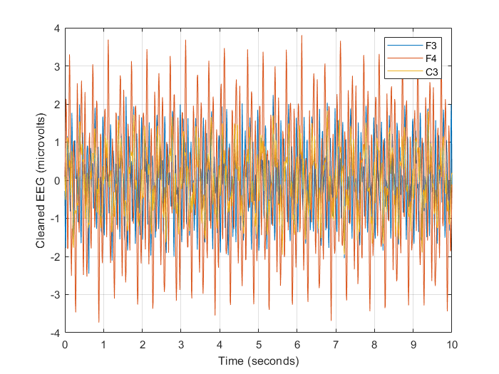

# Synthetic example: BrainVision import, cleaning and QC

Download the [repository ZIP with the example and readiness fixes](https://github.com/MPG-Git/eeg_preprocess_BrainVision/archive/refs/heads/codex/readiness-20261107.zip),
extract it to a writable folder, and follow the setup below. These changes are
on the review branch; downloading the older default branch may omit them.
The input files and reference outputs are already included; generation is optional.

## Run and inspect

This is an EEGLAB workflow run from MATLAB. Install EEGLAB with **bva-io**,
**firfilt**, **clean_rawdata**, **ICLabel**, and **DIPFIT** (the standard montage
is used). Start EEGLAB once so its plugins are available. From this repository:

```matlab
addpath('C:/path/to/eeglab'); % your installation, if not already on the path
eeglab nogui;
addpath('examples/synthetic');
run_brainvision_demo;
```

Reference environment: MATLAB R2023b, EEGLAB 2024.2, bva-io 1.73,
clean_rawdata 2.10, DIPFIT 5.6, plus the installed firfilt and ICLabel plugins.
All three files in `data/` must stay together: `.vhdr` header, `.eeg` binary
samples and `.vmrk` event markers. They contain 120 seconds of eight-channel
synthetic EEG at 100 Hz (microvolts), 59 `S  1` events, mixed 3/7/10/15 Hz sources,
noise and small event-related Gaussian pulses. Generation uses MATLAB seed 8.

The runner calls the actual preprocessing pipeline with a small configuration
grid and seed 7. It adds the FCz reference channel, uses average reference,
filters, runs ASR, ICA and ICLabel, and saves `clean_synthetic.set` plus QC CSVs.
There should be **9 channels at 100 Hz**, finite data and ICLabel classifications.
The across-channel mean must stay below 1e-5 microvolts. Retained-event fraction
must be positive and at most 1, and SNR must be finite.

The reference run retained all 59 eligible events, removed no components, and
had SNR about 0.21115. Comparisons allow 0.10 absolute change in retained fraction
and 0.05 in this implementation's SNR metric; the full reference QC tables are
included for inspection. ICA/ASR results may change with plugin versions.
The 128-step ICA cap and permissive artifact thresholds make a quick setup test;
they are not a recommended configuration for cleaning a study or assessing ICA
convergence. This synthetic example does not establish artifact-removal accuracy.

Load `output/clean_synthetic.set` in EEGLAB to inspect the result.



Recreate inputs with `generate_brainvision_data('new_data')`.

## What counts as success

A successful run prints `PASS` and writes `PASS.txt` and `comparison.csv` into
the new output folder. Errors and mismatches stop the runner without a PASS file.
Open the CSV comparison and compare your plots with `expected/`.
The included reference outputs came from actual runs on November 7, 2026.

The default output is this example's `output/` directory. Existing output folders
are refused so a previous result cannot be mistaken for a fresh run. MATLAB
runners accept a new output folder as their first argument (for example,
`run_brainvision_demo('demo_run_2')`).

If a comparison fails, inspect the reported metric and confirm that you used
these bundled files, this repository version, and the listed dependencies.
Do not replace the reference with the failing result. `SHA256SUMS.json` records
input/reference file hashes for download-integrity checks. All input data are
generated; no participant recordings or personal data are included. The supplied
generators refuse to overwrite an existing destination.

These examples check the illustrated installation and workflow, not every menu
item or scientific validity for a particular study. Reference plots may render
differently with another operating system or graphics version.
